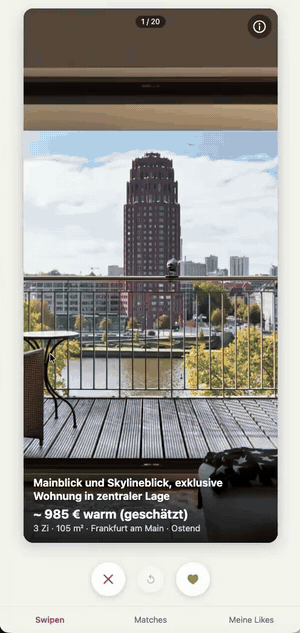

# Wohnungs-Tindern

**Wohnungssuche zum Wischen.** Ein KI-Agent durchsucht jeden Tag ImmoScout24, immowelt, Kleinanzeigen und WG-Gesucht, sortiert alles aus, was nicht passt, und legt dir den Rest als Karten in eine Swipe-App. Wenn alle in eurer Gruppe nach rechts wischen, habt ihr ein Match.

<p align="center">
  
  <br>
  <sub><a href="docs/demo.mp4">Video in voller Qualität</a></sub>
</p>

## Was es macht

1. **Suchen:** Dein Coding-Agent steuert einen echten Browser durch vier Portale, für jede Stadt aus deinen Kriterien, neueste Anzeigen zuerst.
2. **Aussortieren:** Was zu teuer oder zu klein ist, nicht in deinen Städten oder Wunsch-Stadtteilen liegt oder ein WG-Zimmer, Tausch, Zeitwohnen oder WBS-only ist, fliegt raus, bevor du es je siehst. Bei Anzeigen, die nur die Kaltmiete nennen, wird die Warmmiete geschätzt.
3. **Bewerten:** Jede Wohnung bekommt einen Score von 0 bis 100 (Zimmer, Fläche, Balkon, Garten, Badewanne, Erdgeschoss, Preis, Wunsch-Stadtteil) und eine kurze Begründung wie `3 Zi ✓, EG ✓, warm 1.050 €`.
4. **Wischen:** Die Treffer landen mit allen Fotos, Grundriss und Beschreibung in der App. Bereits gewischte Wohnungen tauchen nicht wieder auf, und offline genommene Anzeigen werden automatisch aussortiert.

Dazu gibt es jeden Tag einen kurzen Bericht über die neuen Anzeigen.

## Warum das Zeit spart

Ohne das Tool klickt man jeden Tag vier Portale × alle Städte durch, sieht dieselben Anzeigen immer wieder und liest Exposés, die am Ende doch zu teuer oder ein WG-Zimmer sind. Danach schickt man sich Links hin und her und fragt: „Hast du die schon gesehen?“

Mit Wohnungs-Tindern läuft die Suche morgens automatisch. Du siehst nur neue Wohnungen, die deine harten Kriterien erfüllen, die besten zuerst. Ein Wisch reicht pro Wohnung, und Matches zeigen sofort, worüber ihr euch alle einig seid. So bleibt die Zeit für Besichtigungen und Bewerbungen.

## Multiplayer

Beliebig viele Leute, ein Account pro Person: für Paare, WGs oder die ganze Familie.

- **Match** = alle haben die Wohnung geliked.
- Wohnungen, die andere schon mögen, kommen bei dir zuerst, mit dem Hinweis „💛 Alex & Sam mögen das“.
- **Matches** und **Meine Likes** haben eigene Tabs, deine Likes sortiert nach Score.
- **Einstellungen**: alle Stadtteile eurer Städte mit kurzer Beschreibung, was es dort gibt (Einkaufen, Kultur, Freizeit, Kino, Schwimmbad, Sehenswürdigkeiten, ÖPNV). Pro Stadtteil wählt ihr Egal, Ja, Favorit oder Nein; die nächste Suche richtet sich danach. Die Beschreibungen schreibt der Agent beim Einrichten.
- **Anfrage schreiben**: Aus jeder Wohnung in Likes/Matches entsteht ein fertiger Anschreiben-Text an den Vermieter (per KI über OpenRouter oder lokales Modell, sonst Vorlage) – kopieren und auf dem Portal abschicken.

Lokal läuft die App auf deinem Rechner. Damit alle vom Handy aus wischen können, stellst du sie mit dem Skill `wohnung-deploy` auf einen eigenen Server: Debian mit systemd oder einen beliebigen Linux-Server mit Docker, HTTPS jeweils über Caddy.

## Was du brauchst

- **[Bun](https://bun.sh):** einzige Laufzeit, Installation mit einem Befehl auf macOS, Linux und Windows
- **Einen Coding-Agenten**, z. B. [Claude Code](https://claude.com/claude-code) (empfohlen, ist schon vorkonfiguriert), Codex oder Cursor
- **[Node.js](https://nodejs.org):** für den Playwright-Browser des Agenten (`npx`)
- **[Docker](https://docs.docker.com/get-docker/)** (optional): Dann läuft die Swipe-App im Hintergrund und startet von selbst neu, statt in einem offenen Terminal

Der Browser läuft sichtbar. Taucht ein Captcha auf, löst du es kurz selbst. Bei unbeaufsichtigten Läufen wird das betroffene Portal für den Tag übersprungen.

## Loslegen

### Mit einem KI-Agenten (am einfachsten)

Kopier diesen Prompt in deinen Coding-Agenten (Claude Code, Codex, Cursor …). Er richtet alles ein und fragt dich nur nach deinen Kriterien und Passwörtern:

```text
Richte bitte das Projekt „Wohnungs-Tindern“ lokal bei mir ein.

1. Falls ich nicht schon im Repo bin: Klone https://github.com/posixpascal/wohnungs-tindern.git und hör dann auf. Sag mir, dass ich dich im Ordner `wohnungs-tindern` neu starten und diesen Prompt noch einmal schicken soll, denn Skills und Browser-Tools des Projekts lädst du nur beim Start.
2. Lies AGENTS.md und halte dich an die Regeln dort, vor allem: .env nie lesen oder ausgeben, und Passwörter tippe ich selbst ein. Du siehst, wählst oder übergibst sie nie.
3. Prüfe, ob Bun, Node.js (npx) und Docker installiert sind. Fehlt Bun oder Node.js, sag mir, wie ich es installiere, und warte. Docker ist optional.
4. Führe `bun run doctor` aus.
5. Starte dann den Skill `wohnung-setup` (Claude Code: /wohnung-setup) und arbeite ihn Schritt für Schritt ab: Grundeinrichtung, Kriterien-Interview auf Deutsch, Location-IDs für neue Städte, App starten (per Docker, falls vorhanden), Accounts anlegen und die erste Suche.
6. Gib mir am Ende eine kurze Zusammenfassung auf Deutsch: was eingerichtet ist, wie ich die App öffne und welche Skills ich im Alltag nutze.
```

### Mit Claude Cowork

Kurzversion zum Reinkopieren in eine [Claude-Cowork](https://claude.ai)-Session:

```text
Bitte das Repo https://github.com/posixpascal/wohnungs-tindern einrichten.

- Klone es, wenn wir nicht schon drin sind, und starte in dem Ordner neu, damit du die Projekt-Skills lädst.
- Lies AGENTS.md und halte dich daran: .env nie lesen oder ausgeben; Passwörter tippe ich selbst, du siehst oder übergibst sie nie.
- Prüfe Bun, Node.js (npx) und optional Docker. Fehlt etwas, frag mich kurz („Soll ich Bun installieren?“) und installiere es dann selbst mit dem offiziellen Installer; Docker ist optional.
- Führe `bun run setup` und `bun run doctor` aus und starte dann den Skill `wohnung-setup`. Arbeite ihn auf Deutsch Schritt für Schritt ab (Kriterien, Location-IDs, Stadtteile, App, Accounts, erste Suche).
- Zum Schluss kurze Zusammenfassung: wie ich die App öffne und welche Skills im Alltag wichtig sind.
```

### Von Hand

```sh
git clone https://github.com/posixpascal/wohnungs-tindern.git && cd wohnungs-tindern
bun run setup     # Abhängigkeiten, .env mit Token, Beispiel-Konfiguration
bun run doctor    # zeigt, was fertig ist und was als Nächstes kommt
```

Dann im Agenten den Setup-Skill starten (Claude Code: `/wohnung-setup`). Er fragt Städte, Budget, Zimmer, Fläche und Wünsche ab, startet die App, legt die Accounts an und startet die erste Suche. Danach <http://127.0.0.1:3000> öffnen und loswischen.

Die App läuft entweder per Docker im Hintergrund (`bun run docker:up`, Accounts dann mit `bun run docker:user <name>`) oder im Terminal (`bun run dev`, Accounts mit `bun run user <name>`). Der Setup-Skill nimmt Docker, wenn es installiert ist.

## Neu: Stadtteile filtern

Die Portale suchen immer die ganze Stadt. Damit nur Wohnungen in den Stadtteilen landen, die euch interessieren, kennt das Tool jetzt die Stadtteile jeder Stadt – mit Vorteilen, Einkaufen, Kultur, Kino, Schwimmbad, Sehenswürdigkeiten und ÖPNV.

- **Einstellungen** in der App: pro Stadtteil Nein, Egal, Ja oder Favorit. Lesen kann jeder mit dem Link (`/#einstellungen`), ändern nur, wer eingeloggt ist. Gilt für die ganze Gruppe.
- Jeder Suchlauf (`bun run scrape`, lokal oder per Zeitplan) holt sich vorher diese Auswahl und filtert danach. Ausgeschlossene Wohnungen verschwinden sofort aus dem Stapel und kommen zurück, wenn ihr den Stadtteil wieder erlaubt.

**Schon im Einsatz? Einmal einrichten**, sonst filtert der Agent nicht nach Stadtteilen:

1. `git pull`, dann `bun run doctor` – die Zeile `districts` zeigt, für welche Städte noch Daten fehlen.
2. Sag deinem Agenten: **„Stadtteile einrichten“** (Skill `wohnung-kriterien`). Er recherchiert die Stadtteile jeder Stadt parallel mit Research-Agenten und legt sie in `config/districts/` ab.
3. Server aktualisieren (Skill `wohnung-server`, „update deployen“), dann `bun run districts`, `bun run rescore` und `bun run push`.
4. In der App unter **Einstellungen** die Stadtteile wählen. Ab dem nächsten Suchlauf wird danach gefiltert.

## Im Alltag

| | |
|---|---|
| Suche starten | `/wohnung-suche` im Agenten oder `bun run scrape` |
| Jeden Morgen automatisch | `/wohnung-zeitplan` (macOS/Linux) |
| Kriterien ändern | `/wohnung-kriterien` |
| Stadtteile wählen | Tab **Einstellungen** in der App oder `/wohnung-kriterien` |
| Besichtigungsanfragen für neue Matches | `/wohnung-ansprache` |
| Accounts verwalten | `/wohnung-users` |
| Portal hat sein Layout geändert | `/wohnung-portal-fix` |
| Online stellen / Server pflegen | `/wohnung-deploy`, `/wohnung-server` |

Andere Agenten kennen keine Slash-Commands. Dort sagst du z. B. „Use the wohnung-suche skill“.

## Fair Use

Der Agent loggt sich nirgends ein, schreibt keine Vermieter an und schickt keine Formulare ab. Er arbeitet nacheinander mit Pausen und ruft höchstens 3 Ergebnisseiten pro Portal und Stadt und 80 Exposés pro Tag ab. Bitte halte dich an die Nutzungsbedingungen der Portale.

---

Technische Details (Pipeline, Konfiguration, Scoring, Deployment, Troubleshooting): [docs/reference.md](docs/reference.md) · Für Coding-Agenten: [AGENTS.md](AGENTS.md)
